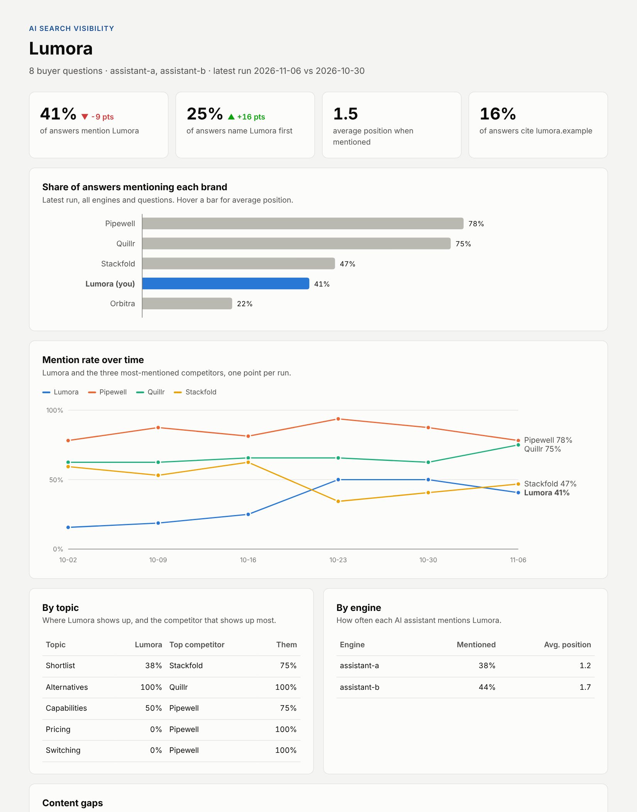

# AI Search Visibility Tracker

**Ask AI assistants the questions your buyers ask. Track whether your brand shows up, how early, whether your site is cited, and which questions competitors are winning.**


**Live report:** https://justfranklin.github.io/ai-search-visibility-tracker/ · **Demo:** [/demo](https://justfranklin.github.io/ai-search-visibility-tracker/demo/)


*Demo report: fictional brands and synthetic answers, generated with `python -m aivis demo`.*

---

## The problem

Buyers now ask ChatGPT, Claude, Perplexity and Gemini questions like "what are good alternatives to X?" before they ever reach a search results page. If your brand isn't in those answers, you aren't on the shortlist. Most marketing teams can't answer basic questions about this channel:

- How often do AI assistants mention us, compared with competitors?
- Which buyer questions do we show up for, and which ones are we missing?
- Is our site being cited as a source?
- Is any of it changing as we publish new content?

## What it does

1. **You define the buyer questions** grouped by topic (shortlists, alternatives, capabilities, pricing, switching), plus your brand and competitors with their aliases and domains.
2. **It asks each question of each AI engine** you have a key for, through their official APIs, with no system prompt, the way a buyer would type it. It can ask more than once, since answers vary.
3. **It reads every answer** for which brands are mentioned, in what order, and whether each brand's domain is cited or linked.
4. **It keeps a history**, one row per brand per answer in `data/results.csv`, plus every raw answer in `data/answers/`, so every number can be traced back to what the AI said.
5. **It builds a report** with mention share, first-mention rate, average position, citation rate, a trend over time, results by topic and engine, and a **content gaps** list: questions where competitors appear and you don't.
6. **It runs weekly on GitHub Actions** and publishes the report to GitHub Pages.

## Metrics

| Metric | Meaning |
|---|---|
| **Mention rate** | Share of answers that name the brand at all |
| **First-mention rate** | Share of answers where the brand is named before any other tracked brand |
| **Average position** | Where the brand appears among tracked brands, when mentioned (1 = first) |
| **Citation rate** | Share of answers whose sources or links include the brand's domain |
| **Content gaps** | Questions where at least one competitor is mentioned and you aren't, in any engine |

## Quick start

```bash
git clone https://github.com/justfranklin/ai-search-visibility-tracker.git
cd ai-search-visibility-tracker
pip install -r requirements.txt

python -m aivis demo                 # no keys needed: demo/index.html

export ANTHROPIC_API_KEY=...         # and/or OPENAI_API_KEY, PERPLEXITY_API_KEY, GEMINI_API_KEY
python -m aivis engines              # see which engines are ready
python -m aivis run                  # ask, record, report -> site/index.html
python -m aivis run --samples 3      # ask each question 3 times for steadier numbers
```

## Configure it for your brand

Everything lives in [`config/tracker.yaml`](config/tracker.yaml). The example tracks marketing automation platforms.

```yaml
brand:
  name: HubSpot
  domain: hubspot.com
  aliases: [HubSpot Marketing Hub]

competitors:
  - {name: Marketo, domain: marketo.com, aliases: [Adobe Marketo, Marketo Engage]}

prompts:
  - {id: alt-marketo, topic: Alternatives, text: "What are good alternatives to Marketo?"}

engines:
  - {id: claude, provider: anthropic, model: claude-sonnet-5-5, key_env: ANTHROPIC_API_KEY}
  - {id: perplexity, provider: perplexity, model: sonar, key_env: PERPLEXITY_API_KEY}
```

Tips for good questions:
- Write them the way a buyer would, not the way your positioning doc would.
- Cover the whole journey: "best X for Y," "alternatives to [competitor]," "X vs Y," "how do I solve [problem]," pricing and switching.
- Keep the IDs stable so the history stays comparable over time.

## Automate it

[`weekly-run.yml`](.github/workflows/weekly-run.yml) runs every Monday:

1. **Settings → Pages →** set the source to **GitHub Actions**.
2. **Settings → Secrets and variables → Actions →** add the API keys for the engines you want.
3. Run it once from the **Actions** tab, or wait for Monday.

With no keys set, it publishes the demo, so the Pages site works from day one.

## Using the results

- **Content gaps → content plan.** Each gap is a buyer question with no answer from you yet. Write the page that answers it directly, with clear headings, comparisons and FAQs that assistants can quote.
- **Low citation rate, decent mention rate** means assistants know the brand but aren't using your site as a source. Strengthen the pages that should be cited (docs, pricing, comparison pages) and earn mentions on the third-party sites assistants rely on.
- **Engine differences** usually come from how each engine retrieves sources. Engines that search the web, like Perplexity, respond faster to new content than answers drawn from model training data.

## Project structure

```
config/tracker.yaml    brand, competitors, questions, engines
aivis/engines.py       Anthropic, OpenAI, Perplexity and Gemini API calls (with retries)
aivis/analyze.py       brand mention, position and citation detection
aivis/run.py           ask every question of every engine
aivis/store.py         results CSV + raw answers (JSONL)
aivis/report.py        metrics, trend, gaps, HTML report with inline SVG charts
aivis/demo.py          fictional brands + synthetic answers for the demo
tests/                 analysis, engine parsing, run, report (no network needed)
```

## Limits

- API answers can differ from the consumer apps, which add personalization, memory and their own search settings. Treat results as a consistent benchmark, not an exact replica of what each person sees.
- Matching is by name and alias. A brand name that's also a common word, or a parent company name used in another context (for example, "Salesforce" as a CRM rather than its marketing product), can overcount. Use specific aliases.
- Small samples are noisy. Use `--samples 3` or more and look at the trend, not a single week.

## License

MIT
